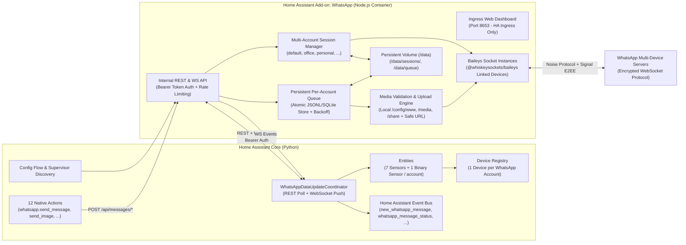

# HA WhatsApp – System Architecture Specification

## 1. High-Level Topology

The HA WhatsApp system splits responsibilities cleanly across two processes communicating over an authenticated local HTTP/WebSocket contract:

---

## 2. Monorepo Compatibility with Home Assistant Add-on Store & HACS

A single GitHub repository (`https://github.com/DrasisAutomation/Lumi-Whatsapp-Addon`) serves both installation mechanisms simultaneously without conflict:

1. **Home Assistant Supervisor Add-on Store**:
   - Reads `/repository.yaml` at the root.
   - Scans immediate subdirectories for `config.yaml` (`whatsapp_addon/config.yaml`).
   - Ignores `custom_components/`, `docs/`, `tests/`, and `hacs.json` because none of those directories contain an add-on `config.yaml`.
2. **HACS (Home Assistant Community Store)**:
   - When added as a Custom Repository with category **Integration**, HACS reads `/hacs.json` and inspects `/custom_components/whatsapp/manifest.json`.
   - Downloads only `/custom_components/whatsapp/` into the user's Home Assistant `<config>/custom_components/whatsapp/` directory.

---

## 3. Networking & Authentication Model

### 3.1 Add-on Ingress (Web UI)
- The add-on enables `ingress: true` on port `8653` in `whatsapp_addon/config.yaml`.
- Home Assistant Supervisor proxies authenticated user browser traffic from the Home Assistant sidebar/add-on panel to `172.30.32.x:8653` with `X-Ingress-Path` and restricts Ingress requests strictly to the Supervisor proxy IP (`172.30.32.2`) unless authenticated with the configured API Bearer token.
- No unauthenticated public port is exposed by default.

### 3.2 Integration-to-Add-on Internal API Communication
- **Primary Path (Supervisor Add-on Discovery / Internal Network)**:
  - The add-on exposes its internal REST and WebSocket API on port `8653` (accessible inside the Hassio Docker network via `http://<addon_hostname>:8653` or optionally via mapped local port if running HA Core/Container outside Supervisor).
  - When `hassio_api: true` discovery is available, the integration can discover the add-on's internal hostname and connection settings, or the user can enter the URL (defaulting to `http://local-whatsapp:8653` or `http://localhost:8653`) and the shared `api_key` configured in the add-on options.
- **Bearer Token Security**:
  - Every `/api/*` request (outside Supervisor Ingress requests from `172.30.32.2`) requires `Authorization: Bearer <API_TOKEN>` (validated using constant-time comparison `crypto.timingSafeEqual`).
  - WebSocket connections (`/ws`) authenticate via `Authorization: Bearer <API_TOKEN>` header (from the Python integration) or via validated Supervisor Ingress peer IP (`172.30.32.2` for the browser dashboard).

---

## 4. WhatsApp Engine & Session Reliability (`whatsapp_addon/`)

### 4.1 Baileys Dependency Strategy
- Package: `@whiskeysockets/baileys` pinned to an exact tested version (`6.7.24` legacy stable or `6.17.16` stable release; evaluated and verified during Milestone 2/3 dependency installation so no unstable floating git commit is used).
- Node.js runtime: Node.js 20 LTS / 22 LTS inside the official Alpine/Debian container image for `amd64` and `aarch64`.

### 4.2 Multi-Account Isolation
Each account (`clientId`, e.g., `default`, `office`, `personal`, `security`, validated against `^[a-zA-Z0-9_-]{1,32}$`) has:
- Dedicated directory `/data/sessions/<clientId>/` for atomic credential and Signal pre-key/session storage.
- Dedicated Baileys socket instance and reconnection state machine.
- Dedicated sequential message queue (`/data/queue/<clientId>.json`) to guarantee ordered delivery and prevent Signal session ratchet race conditions when sending multiple messages or media attachments concurrently.

### 4.3 Atomic Auth State Persistence & Crash Safety
- Standard `useMultiFileAuthState` in Baileys writes directly to files and can corrupt JSON on abrupt container stop.
- We wrap credential and key store writes with **atomic write-then-rename** (`writeFile` to `<file>.tmp.<pid>` + `fsync` + `rename`) and serialized per-file write locks so `/data/sessions/<clientId>/creds.json` and Signal session keys are never truncated on power loss or Docker restart.
- Temporary network failures (`connectionLost`, `timedOut`, `restartRequired`, `5xx`) trigger exponential backoff reconnection **without** deleting `/data/sessions/<clientId>`.
- Only an explicit `DisconnectReason.loggedOut` (401 from WhatsApp when unlinked from phone) marks the session as `logged_out` and prompts the user in diagnostics/UI to re-pair or confirm session reset.

---

## 5. Media Validation & CCTV Snapshot Pipeline

### 5.1 Local File Security
- Allowed root directories inside the add-on container (mounted via `map` in `config.yaml` with least privilege):
  - `/config/www` (mapped via `homeassistant_config:ro` or `config:ro` scoped strictly by realpath validator to `/config/www`, `/media`, and `/share`)
  - `/media` (`media:ro`)
  - `/share` (`share:ro`)
- Path resolution uses `fs.realpath` and verifies the canonical path starts with one of the allowed base directories, blocking `../` traversal and symlink escape attacks.
- Snapshot readiness check (`waitForFileReady`): When sending a freshly captured CCTV snapshot (e.g. `camera.snapshot`), the media manager supports polling for file existence, non-zero size, and size stability across a configurable window (e.g., up to 10 seconds) plus validating JPEG/PNG/WebP/MP4/PDF magic bytes before reading and encrypting the buffer for WhatsApp upload.

### 5.2 Remote URL Security (SSRF Protection)
- Validates `http:` or `https:` protocol.
- Resolves DNS prior to fetch and blocks loopback (`127.0.0.0/8`, `::1`), link-local (`169.254.0.0/16`, metadata endpoints), and private RFC1918 ranges unless the host is explicitly whitelisted in the add-on configuration (`allowed_local_hosts`).
- Enforces strict timeout and maximum byte stream limit (e.g. 50 MB for video/documents, 16 MB for images).

---

## 6. Internal REST & WebSocket API Contract

### 6.1 REST Endpoints
| Method | Endpoint | Purpose |
|---|---|---|
| `GET` | `/api/health` | Add-on health, uptime, version, active accounts summary |
| `GET` | `/api/accounts` | List all configured accounts and their connection states & counters |
| `GET` | `/api/accounts/:clientId` | Detailed status, phone number, last active timestamp, and metrics for one account |
| `POST` | `/api/accounts` | Create/register a new account (`{ clientId, name }`) |
| `POST` | `/api/accounts/:clientId/connect` | Start or reconnect the account session and generate QR if unpaired |
| `POST` | `/api/accounts/:clientId/disconnect` | Gracefully disconnect socket without wiping credentials |
| `DELETE` | `/api/accounts/:clientId` | Delete account and session (`?confirm=true` required) |
| `GET` | `/api/accounts/:clientId/qr` | Retrieve current pairing QR code (data URL + raw string + expiry state) |
| `POST` | `/api/messages/send` | Enqueue & send text or location or audio message |
| `POST` | `/api/messages/send-image` | Validate, encrypt, upload & send image (local path, URL, or base64) |
| `POST` | `/api/messages/send-video` | Validate, encrypt, upload & send MP4 video |
| `POST` | `/api/messages/send-document` | Validate, encrypt, upload & send document |
| `GET` | `/api/messages` | Paginated message history with status (`queued`, `sending`, `sent`, `delivered`, `read`, `played`, `failed`) |
| `GET` | `/api/messages/:messageId/status` | Specific message delivery status and retry telemetry |
| `GET` | `/api/contacts` | Known contacts for a `clientId` |
| `GET` | `/api/groups` | Joined WhatsApp groups and metadata for a `clientId` |
| `POST` | `/api/contacts/check` | Verify if a phone number is registered on WhatsApp (`onWhatsApp`) |
| `GET` | `/api/diagnostics` | Sanitized diagnostics (connection errors, media upload errors, queue stats; zero secrets/PII) |

### 6.2 WebSocket Event Stream (`/ws`)
Emits JSON envelopes `{ type, timestamp, payload }`:
- `connection_update`: `{ clientId, status, phone, qrAvailable, lastConnected, error }`
- `qr_update`: `{ clientId, qrDataUrl, expiresAt }`
- `new_whatsapp_message`: `{ clientId, messageId, sender, senderName, isGroup, groupId, messageType, text, timestamp }`
- `whatsapp_message_sent`: `{ clientId, messageId, to, messageType, timestamp }`
- `whatsapp_message_status`: `{ clientId, messageId, to, status, timestamp, error }`
- `whatsapp_send_message_result`: `{ clientId, queueId, messageId, to, messageType, status, error, timestamp }`
- `stats_update`: Per-account counters (`sent`, `received`, `pending`, `failed`).

---

## 7. HACS Custom Integration Architecture (`custom_components/whatsapp/`)

- **Config Flow (`config_flow.py`)**:
  - Supports Supervisor add-on discovery (`hassio` step) and manual configuration (`user` step: Add-on URL + API Token).
  - Validates connectivity via `GET /api/health` and `GET /api/accounts` before creating the config entry.
- **Coordinator (`coordinator.py`)**:
  - Combines periodic fallback polling (`DataUpdateCoordinator` every 30s) with a persistent background WebSocket listener (`/ws`) with automatic exponential reconnection.
  - Dynamically registers new WhatsApp accounts as Home Assistant Devices when added in the add-on UI.
  - Fires native Home Assistant events (`new_whatsapp_message`, `whatsapp_message_sent`, `whatsapp_message_status`, `whatsapp_send_message_result`, `whatsapp_connection_update`) on the HA event bus.
- **Devices & Entities**:
  - Each `clientId` maps to device `("whatsapp", f"{entry_id}_{clientId}")` named `WhatsApp - <Account Name>`.
  - 7 Sensors + 1 Binary Sensor per account with deterministic `unique_id`s so reloads never duplicate entities.
- **Services (`services.py` + `services.yaml`)**:
  - Registers all 12 actions under domain `whatsapp` with `voluptuous` schema validation and `SupportsResponse.OPTIONAL` where appropriate (`get_contacts`, `get_groups`, `check_number`).
